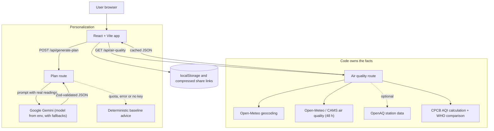

# AirWise 🌬️

**Urban Air Quality & Winter Smog Assistant**
Built for PromptWars Virtual Challenge 06: *"Help families beat severe winter smog with personalized low-emission routines and indoor air hacks."*

🌐 **Live app:** https://airwise-rho.vercel.app
🎥 **Demo video:** [PASTE YOUTUBE LINK]
🔗 **LinkedIn post:** [PASTE LINKEDIN POST LINK]
💻 **Source code:** https://github.com/suvanginihalder-oss/airwise


---

## 1. Problem

Every winter, temperature inversions trap vehicle exhaust, biomass smoke and road dust close to the ground across northern India and other urban centres. Air quality can reach the Severe band, which is hardest on children, pregnant women, older adults and people with respiratory or heart conditions.

Most weather apps show a number and a colour, but little practical help: what to change in a daily routine, how to protect indoor air, or which commute swaps reduce emissions. Many popular tips are also myths, such as the idea that houseplants can clean fine particles from a room.

AirWise combines real air-quality data, deterministic safety guidance based on the CPCB index, and Gemini-written personalization.

---

## 2. Principles

1. **Real data, never invented.** The AI does not calculate or invent pollution figures. TypeScript functions fetch, normalize and calculate every pollutant value and index. The AI only writes advice from the verified numbers placed in its prompt.
2. **Honest about the source.** Readings come from the Open-Meteo Air Quality API, which provides CAMS model data on a grid of roughly 11 km. These are modelled estimates, not ground-station measurements. The app shows the attribution *"Air quality data by Open-Meteo.com, CAMS ENSEMBLE data provider"* and the time of each reading.
3. **Not medical advice.** A short note, *"General guidance, not medical advice,"* appears next to all health guidance.
4. **Useful without AI.** If the AI service is unavailable or rate limited, a deterministic engine produces guidance from the AQI band and the household profile. A banner states the reason, and fallback content is never presented as live AI.

---

## 3. Architecture



### Key modules

- `src/lib/aqi.ts`: CPCB national AQI calculation from PM2.5 and PM10 using breakpoint interpolation across six bands (Good, Satisfactory, Moderate, Poor, Very Poor, Severe), plus comparison with WHO 2021 guideline values.
- `src/lib/timeWindow.ts`: finds the best and worst hours in the 48-hour forecast for outdoor activity and for ventilating a home.
- `src/lib/baselineAdvice.ts`: deterministic advice by AQI band and household profile (masks, school and exercise guidance, indoor filtration).
- `src/lib/emissions.ts`: rough emission estimates for commute swaps, based on published emission factors (sources are listed in the code). They are estimates, not measurements.
- `src/lib/storage.ts`: saved profiles and routine progress in the browser. Read-only share links use `lz-string` compression with no database.

---

## 4. Features

- **Smog advisory banner** when the AQI is Poor or worse, with the top actions to take.
- **AQI gauge and pollutant breakdown**, with text labels and icons for every band and comparison against WHO 2021 guideline values.
- **48-hour forecast chart** (Recharts) with a text summary for screen readers, and the safest and worst time windows derived from the forecast.
- **Personalized routine**: morning, commute and evening tasks as a tickable checklist saved in the browser.
- **Indoor air tips**: a DIY box-fan filter (Corsi-Rosenthal box), ventilation timing, smoke-free cooking, and an explanation of what houseplants can and cannot do.
- **Ask AI chat** with suggested prompts, grounded in the current reading and household profile.
- **Household profiles, share links and print view**, with no account needed.

---

## 5. Accessibility

AirWise is built to WCAG 2.1 AA guidelines. Lighthouse accessibility score: **[ADD YOUR SCORE]**.

- Skip link to the main content.
- Tabs use `role="tablist"` with `aria-selected` and keyboard navigation.
- Dialogs use `role="dialog"` and `aria-modal`, close with `Escape`, and return focus when closed.
- Text colour contrast targets at least 4.5:1, and AQI bands use text and icons, not colour alone.
- Charts include a text alternative (`role="img"`).

---

## 6. Environment Variables

The app works without any keys (baseline advice only). To enable AI personalization, set these in `.env` locally or in your Vercel project settings:

```env
# Provider
LLM_PROVIDER=gemini

# Google Gemini API key (free tier available from Google AI Studio)
GEMINI_API_KEY=your_gemini_api_key_here

# Main model, and fallbacks tried in order if it is out of quota or retired.
# Quotas are counted per model, so use different models in the fallback list.
GEMINI_MODEL=gemini-3.5-flash
GEMINI_FALLBACK_MODELS=gemini-3.5-flash-lite,gemini-flash-lite-latest

# Optional: OpenAQ API key for nearby station readings
OPENAQ_API_KEY=
```

Model names change over time. To list the models available to your key, call the Gemini `models` endpoint, and update `GEMINI_MODEL` if a name is retired. Never commit a real key.

---

## 7. Run Locally

```bash
git clone https://github.com/suvanginihalder-oss/airwise.git
cd airwise
npm install
cp .env.example .env      # optional: add your keys
npm run test:coverage     # unit tests with coverage
npm run lint
npm run dev               # front end at http://localhost:5173
npm run build
```

> `npm run dev` serves only the front end. The `/api` routes run on Vercel, so use `npx vercel dev` to run them locally.

---

## 8. Deploy to Vercel

1. Push the repository to GitHub.
2. Import it in the Vercel dashboard (framework preset: **Vite**).
3. Under **Settings, Environment Variables**, add `GEMINI_API_KEY`, `GEMINI_MODEL` and `GEMINI_FALLBACK_MODELS` (see above), ticked for Production.
4. Deploy. Variables apply only to new deployments, so redeploy after changing one.

`vercel.json` sets a 30-second limit for the API routes.

---

## 9. Limitations

1. **Modelled data.** Open-Meteo readings come from the CAMS model (about 11 km grid) and can differ from the monitor nearest to you. The optional OpenAQ comparison shows station data where available.
2. **Free-tier AI limits.** The Gemini free tier allows only a few requests per minute per model, so some requests may fall back to deterministic advice, always with a visible banner.
3. **Browser storage.** Profiles and routines are stored in the browser. Use a share link to move between devices.
4. **General guidance only.** Advice is not a substitute for medical care.

---

## 10. Data Attribution

Air quality data by [Open-Meteo.com](https://open-meteo.com), CAMS ENSEMBLE data provider (Copernicus Atmosphere Monitoring Service). AQI bands follow the Central Pollution Control Board (CPCB) national AQI; guideline comparisons use WHO 2021 air quality guidelines.
